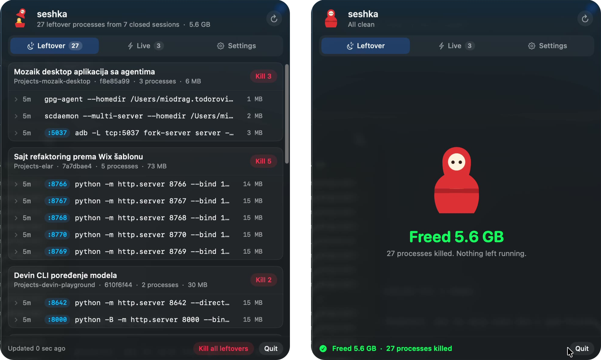

# seshka

**Kill what Claude Code left behind.**

Claude Code sessions end. The dev servers, watchers and emulators they started don't.
seshka is a macOS menu bar app that finds them and kills them.

## What it does

- Finds every process started by a Claude Code session that has since closed.
- Groups them by session, with their ports, memory and age. A session that worked in several git worktrees gets a group for each.
- Catches browsers left open by Playwright and other automation, each as one row.
- Catches what lost its parent on the way (a script that detached itself, an ssh tunnel, a `tail -f`), not only what still hangs off the session.
- Kills one process, one session's worth, or all of them.
- Tells you how much memory they were holding.
- Shows every open session too: whether it is working or idle, for how long, and what it holds.
- Ends idle sessions in one click, or on its own once they have waited longer than you allow (two hours unless you change it; off until you turn it on).
- Shows what sessions left on disk, and removes it when you click: the worktrees Claude Code made for its agents, the scratch files of closed sessions, and caches that fill up again by themselves (Gradle, pnpm, Yarn, Homebrew downloads and others). Only caches a tool refills on its own are offered, so clearing one never leaves something broken.
- Keeps count of what it cleaned up over the last week, and makes a picture of it to share: memory freed, processes killed, sessions ended, disk cleaned. Only the numbers are on it.

The doll in the menu bar is open while something is left behind, and closed when your Mac is clean.
The first time it runs, a short tour shows where it lives and what each tab does. It comes back once after an update that has something new to show.

## Install

**[Download for macOS](https://seshka.dev/download/Seshka.dmg)**, open the disk image and drag Seshka to Applications.

Requires macOS 14 or later, on Apple silicon or Intel. The app is signed and notarized, and keeps itself up to date: it downloads a new version in the background, tells you with a notification, and installs it when you click Restart now or the next time it quits.

To build it yourself:

    scripts/build.sh
    open build/Seshka.app

## How it works

Claude Code sets `CLAUDECODE=1` in the environment of everything it starts, along with the ID of the session
and of its own process. seshka reads those from your running processes. A process is a leftover once the
Claude Code process that started it is gone.

Some apps keep their environment unreadable, Chrome among them. So seshka also counts whatever a marked
process started: a browser opened by Playwright shows up next to the Playwright process that opened it.
An app's helper processes are folded into one row with the app, and go when you kill it.

macOS hides the environment of its own programs too (`/bin/bash`, `/usr/bin/ssh`, `/usr/bin/tail`). For those,
seshka goes by two other traces. Claude Code sends each command's output to a file in a folder named after the
session, so a process still writing there says whose it is. And the marker is handed down from parent to child,
so a parent whose child shows it had it too: the script that keeps restarting a server is listed with the server.

The last trace is the process group. Claude Code starts every command in a group of its own, and whatever the
command starts stays in it, even with no parent, no marker and its output sent elsewhere. seshka asks macOS to
say when an open session starts a command, notes the group then, and knows the process later. This only works
for commands started while seshka is running, and not for a program that leaves its group on purpose, as
`ssh -f` and other daemons do. Those cannot be told from any other process, and are not listed.

On disk, nothing is removed without a click, and nothing that is in use is offered: not a worktree a session or
a process runs in, not the scratch files of a session that is open or wrote to them within the hour. A worktree
with uncommitted changes goes to the Trash instead of being deleted, and removing a worktree never removes its
branch.

What seshka cleans up is counted per day in `~/Library/Application Support/Seshka/history.json`. Only numbers are
kept there, never a name, a command or a path. The picture made from them stays on your Mac until you share it.

Nothing leaves your Mac.

## License

MIT. Copyright (c) 2026 JigJoy. See [LICENSE](LICENSE).

---

Built by the [JigJoy](https://jigjoy.ai) team · Issues: [github.com/jigjoy-ai/seshka/issues](https://github.com/jigjoy-ai/seshka/issues) · Twitter: [@lotus_sbc](https://twitter.com/lotus_sbc)
