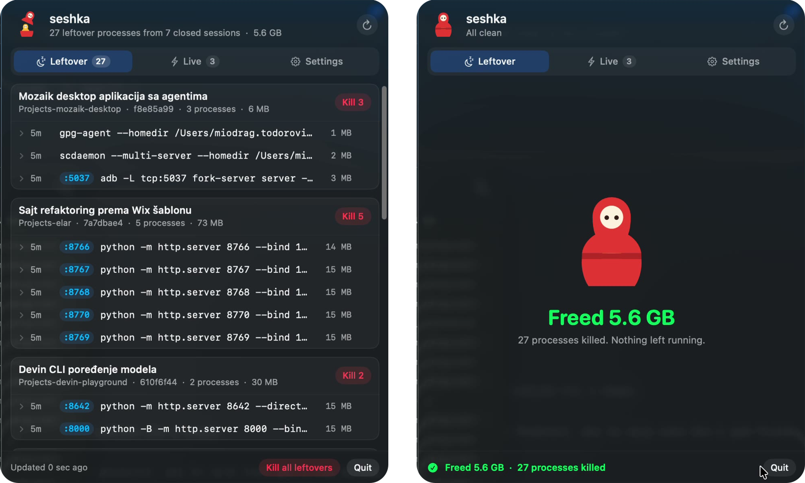

# seshka

**Kill what Claude Code left behind.**

Claude Code sessions end. The dev servers, watchers and emulators they started don't.
seshka is a macOS menu bar app that finds them and kills them.

## What it does

- Finds every process started by a Claude Code session that has since closed.
- Groups them by session, with their ports, memory and age.
- Kills one process, one session's worth, or all of them.
- Tells you how much memory they were holding.

The doll in the menu bar is open while something is left behind, and closed when your Mac is clean.

## Install

Requires macOS 14 or later. A signed download is coming to [seshka.dev](https://seshka.dev). Until then, build it:

    scripts/build.sh
    open build/Seshka.app

## How it works

Claude Code sets `CLAUDECODE=1` in the environment of everything it starts, along with the ID of the session
and of its own process. seshka reads those from your running processes. A process is a leftover once the
Claude Code process that started it is gone.

Nothing leaves your Mac.

## License

[MIT](LICENSE). Free and open source.
